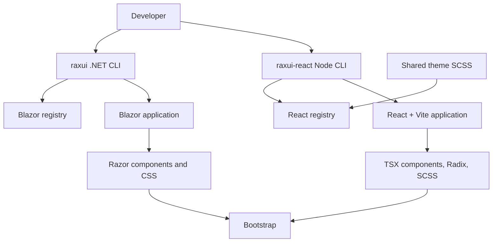

# RaxUI — Architecture

## 1. Purpose

This document defines the technical architecture, project structure, component distribution model, and implementation principles for RaxUI.

RaxUI is an open-source, source-first UI component system for Blazor and React applications. It uses Bootstrap as its styling foundation and one shared theme, and provides a CLI per ecosystem that installs individual components into consumer projects: a .NET CLI for Blazor and a Node CLI for React ([ADR 005](docs/adr/005-multi-framework-shared-theme.md), [ADR 006](docs/adr/006-react-first-milestone.md)).

The architecture prioritizes simplicity, developer ownership, accessibility, maintainability, and a predictable installation experience.

## 2. Architectural Principles

1. **Source-first distribution:** Components are copied into consumer projects as editable source files.
2. **No mandatory runtime service:** Installed components must work without contacting a RaxUI server or registry.
3. **Component-level installation:** Developers install only the components they need.
4. **Explicit dependencies:** Every component declares its component and asset dependencies.
5. **Bootstrap foundation:** Bootstrap provides the base grid, utilities, and selected styling conventions.
6. **Framework-native behavior:** In Blazor, use Razor and C# for component behavior and introduce JavaScript interop only when necessary. In React, use Radix UI primitives for behavior and accessibility.
7. **One theme, delivered per ecosystem:** React compiles the shared theme SCSS with Bootstrap. Blazor receives core `raxui.css`, starter CSS, and per-component compiled CSS, with no consumer Sass build ([ADR 015](docs/adr/015-per-component-css.md)). Both render the same classes and read the same theme attributes.
8. **Safe updates:** The CLI must detect local modifications and never silently overwrite them.
9. **Accessibility by design:** Semantic HTML, keyboard navigation, focus management, and appropriate ARIA attributes are part of component development.
10. **Rendering compatibility:** Components must account for static SSR and interactive Blazor rendering modes.

## 3. High-Level Architecture

The system consists of four main parts:

- **Component Registry:** Stores component manifests, source files, styles, and dependency information, one registry per ecosystem (`registry/blazor/` for Blazor, `registry/react/` for React).
- **CLI:** Initializes applications, resolves dependencies, installs components, manages assets, and performs updates. One per ecosystem, with the same safety rules.
- **Design System:** The shared theme in `theme/scss/`: CSS variables, appearances, accents, density, component styles, and Bootstrap integration, used by both libraries ([ADR 005](docs/adr/005-multi-framework-shared-theme.md), [ADR 007](docs/adr/007-blazor-shared-theme.md)).
- **Consumer Application:** Owns the installed component source code and executes the components as part of its normal Blazor or React application.



The registry and CLI are development-time tools. The consumer application must not require either of them at runtime.

## 4. Repository Structure

The project uses a monorepo to keep the CLI, registry, shared assets, documentation, samples, and tests versioned together. The tree below is a long-term map, not an instruction to scaffold every project. The first milestone CLI and installation tests are implemented. The first implementation milestone is limited by [ADR 002](docs/adr/002-first-milestone-scope.md) and [ADR 004](docs/adr/004-simplified-first-milestone.md); the first React milestone by [ADR 006](docs/adr/006-react-first-milestone.md).

React additions for the first React milestone:

```text
RaxUI/
├── theme/scss/                  shared theme (tokens, appearance, accents, mixins, …)
├── registry/react/
│   ├── index.json
│   ├── foundation/              theme.tsx, utils.ts, manifest.json
│   └── components/button/       button.tsx, manifest.json
├── src/react-cli/               Node CLI: init, add button
├── tests/react/                 component, CLI, and acceptance tests
├── package.json                 private Node tooling for tests
└── tsconfig.json
```

React starters live at `registry/react/starter-react/` (Vite) and `registry/react/starter-next/` (Next.js).

The .NET CLI embeds `registry/blazor/` (as `registry/` resources); the Node CLI bundles `registry/react/`.

Long-term Blazor map:

```text
RaxUI/
├── src/
│   ├── RaxUI.Cli/
│   │   ├── Commands/
│   │   │   ├── InitCommand.cs
│   │   │   ├── AddCommand.cs
│   │   │   ├── ListCommand.cs
│   │   │   ├── UpdateCommand.cs
│   │   │   ├── DiffCommand.cs
│   │   │   ├── RemoveCommand.cs
│   │   │   └── DoctorCommand.cs
│   │   ├── Configuration/
│   │   ├── Registry/
│   │   ├── Installation/
│   │   ├── Bootstrap/
│   │   └── Program.cs
│   │
│   └── RaxUI.Registry/
│       ├── Models/
│       ├── Validation/
│       └── DependencyResolution/
│
├── registry/
│   ├── registry.json
│   ├── styles/
│   │   └── raxui.css         core plus managed import list (ADR 015)
│   │   └── components/         generated per-component CSS
│   └── components/
│       ├── button/
│       │   ├── manifest.json
│       │   └── Button.razor
│       ├── input/
│       │   ├── manifest.json
│       │   └── Input.razor
│       └── dialog/
│           ├── manifest.json
│           └── Dialog.razor
│
├── templates/
│   ├── blazor-webapp/
│   ├── blazor-server/
│   └── blazor-wasm/
│
├── samples/
│   ├── RaxUI.Sample.WebApp/
│   ├── RaxUI.Sample.Server/
│   └── RaxUI.Sample.Wasm/
│
├── tests/
│   ├── RaxUI.Cli.Tests/
│   ├── RaxUI.Registry.Tests/
│   ├── RaxUI.Components.Tests/
│   └── RaxUI.Integration.Tests/
│
├── docs/
│   └── adr/
│
├── Directory.Build.props
├── Directory.Packages.props
├── ARCHITECTURE.md
├── PROJECT_BRIEF.md
├── RaxUI.slnx
├── README.md
├── CONTRIBUTING.md
└── LICENSE
```

The initial implementation should avoid creating unnecessary projects or abstractions. Additional projects can be introduced when a concrete responsibility justifies them.

## 5. CLI Architecture

The CLI is the main entry point for developers using RaxUI.

### 5.1 Responsibilities

The CLI is responsible for:

- Detecting and validating the target Blazor project.
- Creating and validating `raxui.json`.
- Downloading and validating registry manifests and files.
- Resolving component dependencies.
- Copying source files and assets.
- Tracking installed versions and file hashes.
- Managing the Bootstrap assets selected by the project.
- Detecting file conflicts and generating diffs.
- Reporting configuration and installation problems.
- Replacing the unmodified framework template layout and pages with the RaxUI starter during `init`, keeping anything the developer changed ([ADR 008](docs/adr/008-starter-app.md)).

The CLI should not contain component-specific UI logic. Component definitions and dependencies belong in the registry.

### 5.2 Initial Commands

```bash
raxui init
raxui add button
```

Only `init` and `add button` belong to the first implementation milestone. `list`, `update`, `diff`, `remove`, `doctor`, `theme init`, and `bootstrap update` are deferred. Configuration and lock metadata are required from the first installation even though update commands come later.

### 5.3 Internal Flow

The `add` command follows this sequence:

1. Read `raxui.json`.
2. Load the requested component manifest.
3. Validate compatibility and requirements.
4. Resolve transitive component dependencies.
5. Determine all required source files and assets.
6. Detect existing files and possible conflicts.
7. Validate downloaded content and file integrity.
8. Copy files into the configured destinations.
9. Update the installation lock file.
10. Report installed files and any required manual actions.

Validate the complete installation plan before writing. Stage files and preserve originals for rollback; write the lock file last. An ordinary failure must restore previous contents and remove newly created files. Interrupted-process recovery must be designed and tested before a public release. Repeated commands must not duplicate links or imports, adopt unknown files, or overwrite modified files.

### 5.4 React CLI

`src/react-cli` is a Node CLI (`npx @raxui/react`, provisional name) for React applications on Vite 6 or later or Next.js 15 or later with the App Router ([ADR 006](docs/adr/006-react-first-milestone.md), [ADR 010](docs/adr/010-vite-6-and-later.md), [ADR 011](docs/adr/011-nextjs.md)). For Next.js it installs under the source root (project root or `src/`), imports the stylesheet from `app/layout.tsx`, and installs the starter as `app/page.tsx`. The first React milestone provides only `init` and `add button`.

- `init` checks for Vite and `src/main.tsx` or `src/main.jsx`, copies the foundation (`src/lib/theme.tsx`, `src/lib/utils.ts`, theme partials under `src/styles/raxui/`), creates `src/styles/raxui.scss`, adds one import to the entry, and installs pinned npm packages with `npm install --ignore-scripts`.
- `add button` copies `src/components/ui/button.tsx` and its SCSS partial, rewrites `@/lib/*` imports to relative paths, and adds the partial to `src/styles/raxui.scss` once.
- Configuration is `raxui.react.json`; the lock is `raxui.react.lock.json`.
- It follows the same safety rules as the .NET CLI: path and link checks, refusal of unknown or modified files, refusal of silent updates from another release, staged writes with rollback, lock written last, and refusal of files written by a newer release.

## 6. Registry Architecture

The initial registry is static and version-controlled. It may be hosted on GitHub or a static hosting provider.

No custom registry backend is required for the MVP.

Published registry releases are immutable, versioned snapshots. Configuration selects an exact release; installation never resolves through a mutable branch such as `main` or an unpinned `latest` URL. Each snapshot pins exact component and asset versions. Corrections require a new release. See [ADR 003](docs/adr/003-installation-and-registry-contract.md).

**First milestone ([ADR 004](docs/adr/004-simplified-first-milestone.md)):** the registry is embedded in the CLI package, and the CLI package version is the registry version. No remote download or hosting is implemented; manifests are still validated and hashed before any write.

### 6.1 Registry Index

`registry/blazor/registry.json` contains the list of available components and their manifest locations.

Conceptual example:

```json
{
  "schemaVersion": 1,
  "name": "RaxUI",
  "version": "0.1.0",
  "components": [
    {
      "name": "button",
      "manifest": "components/button/manifest.json"
    },
    {
      "name": "input",
      "manifest": "components/input/manifest.json"
    }
  ]
}
```

### 6.2 Component Manifest

Each component has a `manifest.json` defining its metadata, source files, and dependencies.

Conceptual example:

```json
{
  "schemaVersion": 1,
  "name": "button",
  "version": "0.1.0",
  "description": "A customizable button component.",
  "dependencies": [],
  "assets": [
    { "source": "styles/components/button.css", "destination": "styles", "target": "components/button.css", "type": "css" }
  ],
  "files": [
    {
      "source": "Button.razor",
      "destination": "components",
      "target": "Button/Button.razor",
      "type": "razor"
    }
  ]
}
```

Since [ADR 007](docs/adr/007-blazor-shared-theme.md), themed components ship no `.razor.css`; their styles are component-owned assets in `wwwroot/css/raxui/components/<name>.css`, imported by the core stylesheet ([ADR 015](docs/adr/015-per-component-css.md)).

This abbreviated example is not an installable manifest. The schema must require SHA-256 hashes, framework requirements, shared asset references, and exact dependency versions. `destination` selects a configured base directory; `target` is relative to it. Registry templates use explicit namespace tokens, never broad text replacement (deferred: in the first milestone there is no substitution, per ADR 004). Reject unsupported schema versions and file types before writing.

### 6.2.1 React Manifest

React component manifests in `registry/react/components/<item>/manifest.json` share the same concepts ([ADR 006](docs/adr/006-react-first-milestone.md)):

```json
{
  "schemaVersion": 1,
  "name": "button",
  "version": "0.1.0",
  "requires": ["foundation"],
  "packages": { "@radix-ui/react-slot": "1.5.0" },
  "styles": ["components/button"],
  "files": [
    { "source": "registry/react/components/button/button.tsx", "target": "components/ui/button.tsx", "type": "tsx", "sha256": "…" },
    { "source": "theme/scss/components/_button.scss", "target": "styles/raxui/components/_button.scss", "type": "scss", "sha256": "…" }
  ]
}
```

`source` is relative to the repository root and must be under `registry/react/` or `theme/scss/`; the packed CLI keeps the same layout. `target` is relative to the consumer's `src/`: `tsx` and `ts` files go under `lib/` or `components/ui/`, `scss` files under `styles/raxui/`. File types are `tsx`, `ts`, and `scss`. `requires` lists other registry items, `packages` exact npm versions, and `styles` the SCSS partials to import, in order. The same rejection rules apply before writing. Values above are illustrative.

### 6.3 Dependency Resolution

As the component catalog expands, the resolver must support:

- Component-to-component dependencies.
- Shared stylesheet and JavaScript dependencies.
- Bootstrap requirements.
- Detection of circular dependencies.
- Missing or incompatible dependency detection.
- Stable, deterministic installation order.

For example, a dialog may depend on shared overlay and focus-management utilities. These dependencies must be declared explicitly rather than inferred from component names.

The first milestone validates Button's declared shared assets. General component graph resolution is deferred until needed; unsupported requirements must be rejected rather than ignored.

## 7. Source-First Component Model

Every component is distributed as editable source code.

A typical component contains:

```text
Button/
└── Button.razor
```

The `.razor` file defines markup, parameters, and component behavior. It renders the shared class names; its styles come from `components/<name>.css`, installed by `add` and imported once by the core `raxui.css` ([ADR 015](docs/adr/015-per-component-css.md)).

A React component is a `.tsx` file with a matching SCSS partial:

```text
src/components/ui/button.tsx
src/styles/raxui/components/_button.scss
```

The `.tsx` file uses Radix primitives for behavior (Button uses `@radix-ui/react-slot` for `asChild`), reads the theme through `useRaxTheme`, and renders the shared class names. The partial is compiled with Bootstrap and the theme through `src/styles/raxui.scss`. React components forward refs, pass through native attributes, accept `className`, and default `type` to `button` where relevant.

### 7.1 Component Guidelines

Components should:

- Follow standard Blazor parameter and event patterns.
- Support `AdditionalAttributes` when applicable.
- Allow consumer-defined CSS classes.
- Use semantic HTML.
- Avoid unnecessary JavaScript dependencies.
- Keep public APIs small and consistent.
- Work without registry access after installation.
- Document accessibility and interactive behavior.
- Avoid assuming a specific hosting model unless explicitly documented.

### 7.2 CSS Loading Strategy

Blazor follows [ADR 001](docs/adr/001-hybrid-css.md) for link rules and [ADR 007](docs/adr/007-blazor-shared-theme.md) for component styles:

- Global Bootstrap CSS from the template provides layout, utilities, and `.btn`.
- Global `raxui.css`, compiled from `theme/scss` by `theme/build-css.mjs`, provides tokens, appearances, accents, density, and a leading managed import list. `init` imports the starter CSS; `add` imports only installed styled components, dependencies first. Each component owns its CSS in the lock. Edited component CSS is kept; manually edited core CSS is refused before writes. `FileBackup` restores both assets and imports on failure, and the lock is written last.
- The application's own `.razor.css` files keep working through the generated bundle.

The supported host loads styles in this order: Bootstrap, `raxui.css`, the application's generated `{AssemblyName}.styles.css`, then any explicit consumer overrides. Source order does not override CSS specificity; CSS variables and component parameters are the primary customization API.

`init` adds each required link exactly once in `Components/App.razor`, using the supported template's static asset conventions. It preserves existing unrelated links and verifies the generated styles bundle reference using the evaluated assembly name. It must detect an existing Bootstrap reference before adding another. Ambiguous custom host markup produces actionable instructions instead of speculative rewrites.

Do not link individual `.razor.css` files or modify generated CSS bundles. Prefer theme attributes, variables, and component APIs over coupling to component markup.

## 8. Bootstrap Integration

Bootstrap provides the foundational grid, responsive utilities, and selected styling primitives.

The CLI should manage a pinned Bootstrap version locally by default.

**First milestone ([ADR 004](docs/adr/004-simplified-first-milestone.md)):** `init` uses the Bootstrap shipped by the `dotnet new blazor` template in `wwwroot/lib/bootstrap/` and fails with an actionable message if it is missing. The requirements below apply once managed Bootstrap is implemented.

Requirements:

- Track the Bootstrap version in configuration and lock metadata.
- Install Bootstrap assets into a predictable directory.
- Avoid overwriting user-managed Bootstrap files.
- Provide a controlled update workflow.
- Document which Bootstrap classes and utilities RaxUI expects.
- Avoid using Bootstrap JavaScript for behavior already managed by Blazor.

The initial implementation should use Bootstrap CSS as the foundation while allowing RaxUI to define its own component appearance.

## 9. Configuration and Locking

### 9.1 Application Configuration

The `raxui.json` file stores project-level settings.

Conceptual example:

```json
{
  "schemaVersion": 1,
  "framework": "blazor",
  "targetFramework": "net10.0",
  "registryVersion": "0.1.0",
  "componentsPath": "Components/UI",
  "componentsNamespace": "MyApp.Components.UI",
  "stylesPath": "wwwroot/css/raxui",
  "bootstrap": {
    "managed": true,
    "version": "PINNED_VERSION"
  },
  "theme": {
    "default": "light",
    "darkMode": true,
    "rtl": true
  }
}
```

`PINNED_VERSION` is a placeholder. The actual Bootstrap version must be selected and validated before release.

`componentsPath` and `stylesPath` are relative to the explicitly selected consumer project. Detect the evaluated MSBuild `RootNamespace` and `AssemblyName` rather than inferring them from a folder name. Default `componentsNamespace` to `<RootNamespace>.Components.UI` and allow an explicit override. Generated components declare this namespace explicitly; add its `@using` once to the applicable `_Imports.razor`. Validate namespaces and safely substitute only documented template tokens. A later path or namespace change is a migration, not an implicit move during `add`.

**First milestone ([ADR 004](docs/adr/004-simplified-first-milestone.md)):** `componentsPath`, `stylesPath`, and `componentsNamespace` are fixed to the defaults and not configurable. Each component installs into `Components/UI/<Name>/`. Components declare no `@namespace`; Razor derives `<RootNamespace>.Components.UI.<Name>` from the folder, and `add` adds that `@using` once per component to `Components/_Imports.razor`. Component source is `.razor` only. `bootstrap.managed` is `false`.

### 9.2 Lock File

`raxui.lock.json` records the exact versions and installed files.

It should track:

- Installed component versions.
- Registry schema version.
- Exact registry release identity and manifest digest.
- Installed file paths.
- Original file hashes.
- Registry source hashes and installed hashes after namespace substitution, stored separately.
- Asset versions and hashes.
- Relevant compatibility metadata.

The lock file allows the CLI to determine which files belong to RaxUI and whether they have been modified locally.

## 10. Safe Update Strategy

Source ownership means developers may modify installed components. Updates must respect these changes.

For each managed file, the CLI compares the current file with the original installed hash.

- **Unmodified file:** The CLI may replace it with the newer registry version.
- **Modified file:** The CLI must preserve it and present a diff or conflict workflow.
- **New file:** The CLI may install it if the destination is available.
- **Removed upstream file:** The CLI must not automatically delete a locally modified file.
- **Unknown file:** The CLI must not assume that it owns the file.

The first release may use a manual conflict-resolution workflow. Automatic three-way merging is outside the MVP scope.

This section specifies a later milestone. The first milestone only records baseline hashes and refuses conflicting installation; it does not implement updates or diff generation.

## 11. Blazor Rendering Compatibility

RaxUI must distinguish between component rendering and browser interactivity.

The tested support targets are Blazor Web Apps on .NET 8, 9, 10, and 11 in every render mode: static SSR, Interactive Server, Interactive WebAssembly and Interactive Auto, including prerendering ([ADR 009](docs/adr/009-dotnet-8-9-10.md), [ADR 021](docs/adr/021-blazor-render-modes.md)). For WebAssembly and Auto, the CLI runs in the server project and installs components into the referenced `.Client` project. `init` reads the target framework, finds the template Bootstrap (`wwwroot/bootstrap/` on .NET 8, `wwwroot/lib/bootstrap/` on 9, 10, and 11), upgrades the unmodified .NET 8 Bootstrap 5.1 to 5.3, and writes links in each template's form (plain URLs on .NET 8, `@Assets[...]` on 9, 10, and 11). Standalone WebAssembly (`blazorwasm`) and additional hosting models are future support targets until tested. Reusable components do not hard-code `@rendermode`; the consumer selects interactivity at the page or application boundary.

### Static SSR

Components that only render markup and CSS should work without interactive rendering.

Components that require browser interaction must clearly document their interactivity requirements.

### Interactive Server

Component event handling runs through the server-side Blazor circuit. JavaScript interop must account for circuit lifecycle and browser availability.

### Interactive WebAssembly

Components must avoid relying on server-only APIs or server-side state. Any browser-specific behavior must be compatible with WebAssembly execution.

### Blazor Web App

Components must support the applicable rendering modes and avoid assuming that JavaScript is available during static rendering.

### JavaScript Interop Rules

- Do not invoke browser-dependent JavaScript during static rendering.
- Initialize browser-dependent behavior only after interactive rendering is available.
- Use JavaScript only for functionality that cannot be implemented reliably with Blazor alone.
- Keep JavaScript dependencies explicit in component manifests.
- Ensure initialization and disposal are safe across component lifecycle changes.

## 12. Theming, RTL, and Accessibility

The design system uses CSS custom properties for runtime customization.

It should support:

- Light and dark themes.
- Custom colors, borders, spacing, and radii.
- Right-to-left layouts using `dir="rtl"`.
- Logical CSS properties such as `margin-inline-start`.
- Responsive layouts and Bootstrap utilities.
- Keyboard navigation and focus management.
- Appropriate accessible names and ARIA attributes.

Components should not rely on color alone to convey meaning. Interactive components must have defined keyboard and focus behavior.

### 12.1 Shared Theme Contract

The shared theme in `theme/scss/` ([ADR 005](docs/adr/005-multi-framework-shared-theme.md)) is driven by attributes that any element may carry:

- `data-bs-theme`: `light` or `dark`.
- `data-rax-appearance`: `default` (opaque surfaces, moderate shadow), `flat` (no elevation), or `glass` (translucent surfaces with backdrop blur; opaque where `backdrop-filter` is unsupported or the user prefers reduced transparency).
- `data-rax-accent`: `emerald`, `indigo`, or `amber`; omitted for Bootstrap's default colors.
- `data-rax-density`: `comfortable` or `compact`.
- `dir`: `ltr` or `rtl`.

Appearances set semantic tokens (`--rax-surface-bg`, `--rax-border-color`, `--rax-control-shadow`, `--rax-control-radius`, `--rax-surface-filter`); components consume those tokens and never test the appearance name. Precedence: explicit component value, then nearest scope, then application, then `default`.

In React, `RaxThemeProvider` and `RaxAppearanceScope` carry the theme through context and render the attributes; a component's `appearance` prop overrides it. Blazor components render inline, so the attributes reach them through ordinary DOM inheritance: put them on `<html>` or any wrapper, and use a component's `Appearance` parameter to override ([ADR 007](docs/adr/007-blazor-shared-theme.md)). `CascadingValue` will be needed only for components that render outside their parent's subtree.

## 13. Testing Strategy

### Unit Tests

Test registry parsing, manifest validation, dependency resolution, version handling, hashing, and configuration.

### CLI Tests

Test initialization, installation, repeated execution, conflict detection, updates, and failure recovery.

### Component Tests

Use bUnit for Blazor component rendering, parameters, event callbacks, and state behavior where appropriate. Use Vitest with Testing Library for React components: rendering, props, refs, appearance inheritance, and keyboard behavior.

### Theme Tests

Compile `theme/scss` with Bootstrap and each component partial, and check that the output contains the appearance, mode, and reduced-transparency rules.

### Browser Tests

Use Playwright to validate:

- Application startup.
- Component interactions.
- CSS loading.
- Dialog focus management.
- Keyboard accessibility.
- Light and dark themes.
- RTL layouts.
- Representative Blazor rendering modes.
- React: a new Vite application built after `init` and `add button`, with appearance, mode, and direction switches.

CI should build and test all maintained projects and validate that generated consumer applications compile. The .NET and Node jobs both run on every change, since the shared theme can affect either library.

## 14. Security and Reliability

The CLI downloads files from a registry, so downloaded content must be treated as untrusted until validated.

The implementation should:

- Use HTTPS for remote registries.
- Validate paths to prevent directory traversal.
- Reject rooted paths, traversal segments, and destinations escaping the selected project, including symlink or junction escapes.
- Verify file hashes against trusted manifest metadata.
- Reject unexpected paths and unsupported file types.
- Avoid executing downloaded scripts during installation.
- Avoid silently overwriting files.
- Report failed downloads and partial installation recovery clearly.

Registry release integrity and reproducible packaging should be considered before the first public release.

## 15. Architecture Decision Records

Significant technical decisions should be documented in `docs/adr/`.

Accepted ADRs:

- [001 — Hybrid CSS](docs/adr/001-hybrid-css.md)
- [002 — First milestone scope](docs/adr/002-first-milestone-scope.md)
- [003 — Installation and registry contract](docs/adr/003-installation-and-registry-contract.md) (partially superseded for the first milestone by 004)
- [004 — Simplified first milestone](docs/adr/004-simplified-first-milestone.md)
- [005 — Multi-framework repository and shared theme](docs/adr/005-multi-framework-shared-theme.md)
- [006 — React first milestone](docs/adr/006-react-first-milestone.md)
- [007 — Blazor uses the shared theme](docs/adr/007-blazor-shared-theme.md)
- [008 — Starter app replaces the template shell](docs/adr/008-starter-app.md)
- [009 — Blazor on .NET 8, 9, 10, and 11](docs/adr/009-dotnet-8-9-10.md)
- [010 — React on Vite 6 and later](docs/adr/010-vite-6-and-later.md)
- [011 — Next.js 15+ (App Router)](docs/adr/011-nextjs.md)
- [012 — SheenUI identity and existing applications](docs/adr/012-sheenui-identity.md) (superseded by 022)

- [015 — Per-component CSS and aligned React registry layout](docs/adr/015-per-component-css.md)
- [022 — RaxUI identity](docs/adr/022-raxui-identity.md)

ADRs should record the context, decision, alternatives considered, and consequences.

## 16. Implementation Order

Implementation should proceed in small, verifiable milestones:

The CLI, embedded Button registry, installation tests, and browser verification implement the first milestone. The sequence below describes the development order; additional components and hosting modes remain future work.

1. Finalize project conventions and repository structure.
2. Design and validate the registry manifest schema.
3. Implement registry parsing and validation for Button and its shared assets.
4. Create the .NET CLI foundation.
5. Implement project detection and `raxui init`.
6. Implement `raxui add` for a simple Button component.
7. Install and reference component CSS reliably.
8. Add installation tracking and safe update detection.
9. Validate generated applications with automated tests.
10. Expand the component catalog only after the end-to-end workflow is reliable.

## 17. Definition of Architectural Success

The architecture is successful when a developer can initialize RaxUI in a supported Blazor application, install a component and its dependencies, customize the resulting source files, build and run the application without a remote runtime dependency, and safely inspect future updates.

The initial priority is a reliable end-to-end source installation workflow, not a large component catalog or unnecessary infrastructure.
